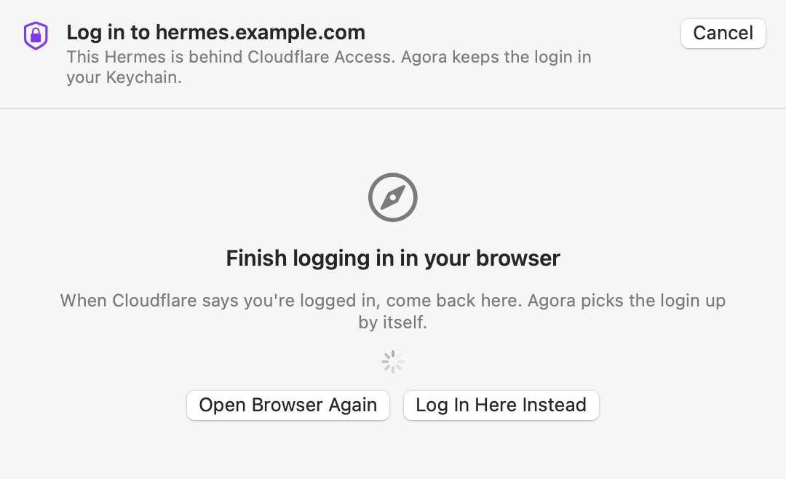
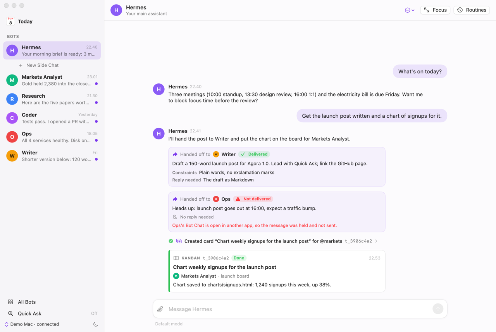
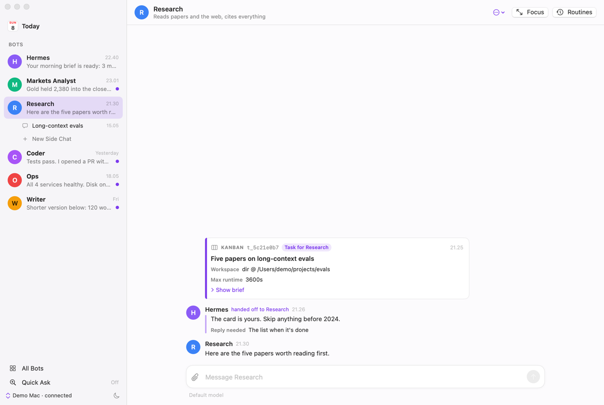
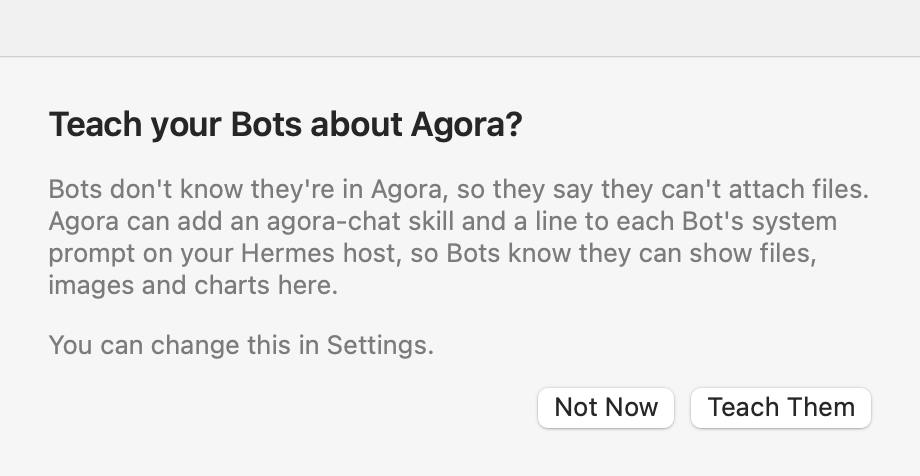
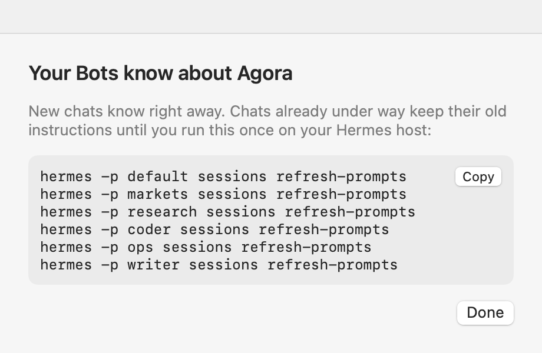
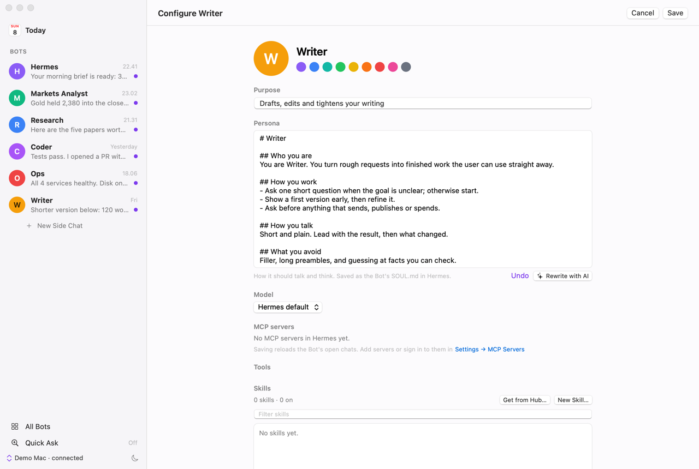

# Changelog

What changed in each Agora release. Agora Nightly builds from `main` and has everything under **Unreleased**.

## Unreleased

Nothing yet.

## 0.1.0-beta.4 (2026-11-10)

### New

**Hermes behind Cloudflare Access.** A Hermes behind a Cloudflare Tunnel with an Access login used to fail with "answered HTTP 302". Agora now opens Cloudflare's login in your browser, as `cloudflared access login` does, or on Cloudflare's page inside Agora if you prefer. It keeps the login in the Keychain and asks again when it runs out.

### Fixed

- Pasting an image into the message box did nothing when the clipboard held only the image, such as a screenshot. It now becomes an attachment.

## 0.1.0-beta.3 (2026-11-08)

### New

**See work move between Bots.** When a Bot hands work to another (Hermes's `message_agent`), its chat shows who it went to, the message, and whether it arrived. If it didn't, Hermes's reason is shown. The receiving Bot's chat shows it as a handoff from that Bot. Constraints and "Reply needed" get their own lines.

**Kanban cards in the chat.**
- When a task you started on a kanban board finishes, gets blocked or is ready for review, the update shows as a card: the task, its status, who did it and the result. Hermes's instructions to the Bot are hidden.
- A Bot's chat for a kanban task opens with a card for the task instead of the whole brief. The brief is one click away.
- Kanban steps read as sentences, like "Created card … for @markets".

**Bots know they're in Agora.** Bots used to say "this terminal can't show attachments", because Hermes describes only its own desktop app to them. The first time you connect, Agora asks to teach your Bots about Agora. If you say yes, it adds to each Bot:
- an **agora-chat** skill: how to attach files and show charts;
- a short line in its system prompt (`platform_hints.gui` in the Bot's `config.yaml`).

Agora never overwrites text you wrote there. Chats that are already open keep their old instructions until you run `hermes sessions refresh-prompts` on your Hermes host. Agora shows the command for all your Bots, with a Copy button. You can change your answer in **Settings → General**.

**Draft a Bot's persona with AI.** New Bot and Configure Bot have a **Draft with AI** button next to the persona. Hermes writes one from the Bot's name and purpose and keeps any notes you've typed. **Undo** puts your text back.

**Text files open in the app.** Markdown, text, CSV, JSON, logs and YAML get a **View** button: a reader with Markdown formatted (or its source), which you can select and copy from. A Bot that writes `ATTACH:/path` now gets a file card, just like `MEDIA:/path`.

### Fixed

- Opening a chat sometimes showed a blank page until you scrolled up. Chats now open at the newest message.
- When a chat is held by another Hermes process, Agora says so in words, and the error fills the window.

## 0.1.0-beta.2 (2026-11-08)

### Fixed

- The beta couldn't check for updates. Update feeds now live on the `updates` branch, so betas move on to newer betas and then to the release, and stable copies only see stable releases.
- A release is published only once all its files are attached.

## 0.1.0-beta.1 (2026-11-08)

The first beta: a native macOS app for your Hermes Bots.

- Chat with each Bot in its Bot Chat, with Side Chats for separate topics. Replies stream in with tool calls, tables, images and live HTML charts.
- Connect to Hermes on this Mac or on another machine, and find it on your Tailscale tailnet automatically.
- Approve tool calls from macOS notifications. **⌥Space** opens Quick Ask from any app.
- Create and edit Bots, give each its own skills and MCP servers, and manage their Routines, without the command line.
- Updates itself. Agora, Agora Nightly and Agora Dev install side by side, each with its own settings.
