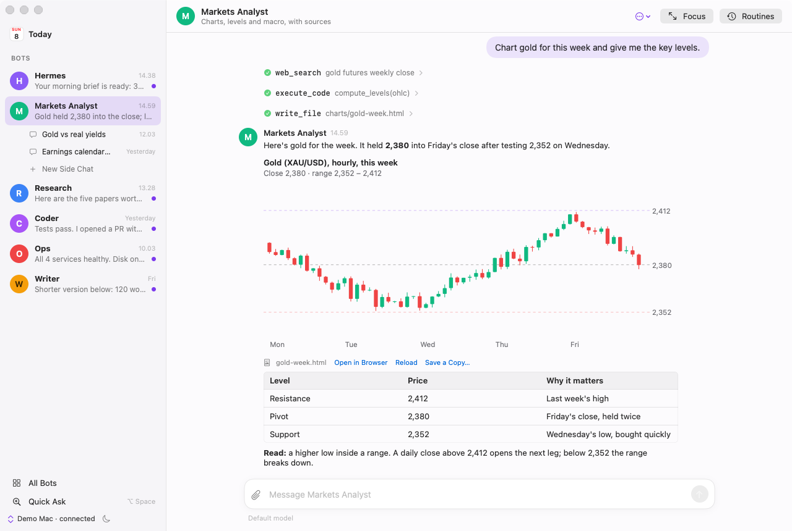
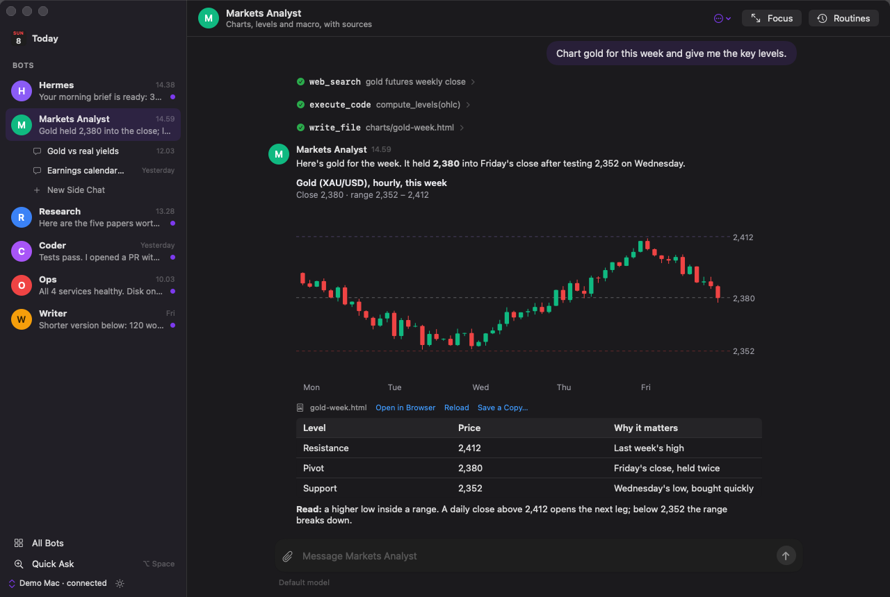
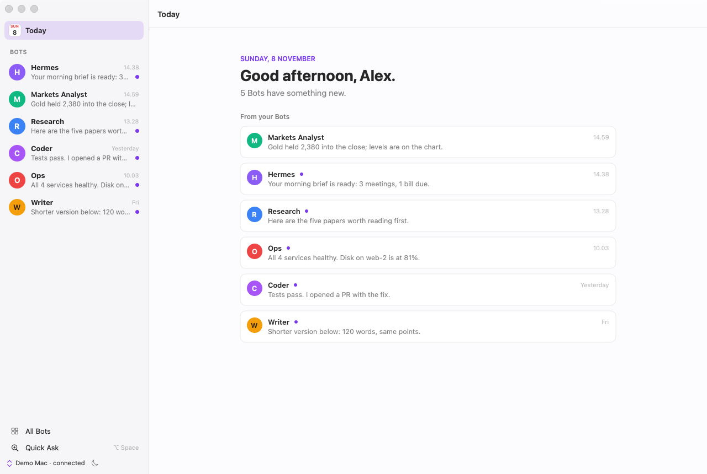
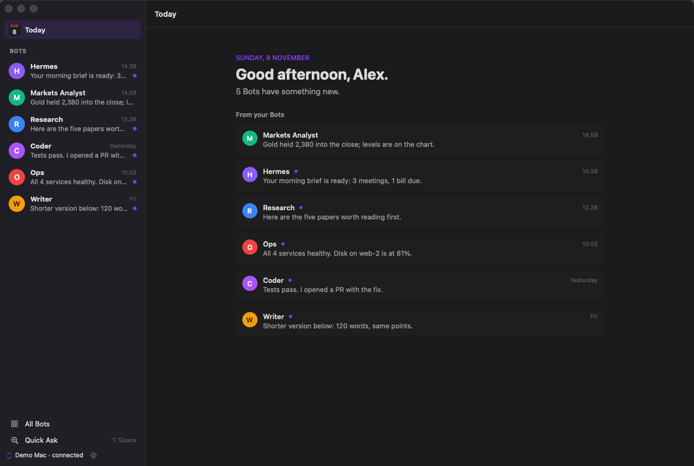
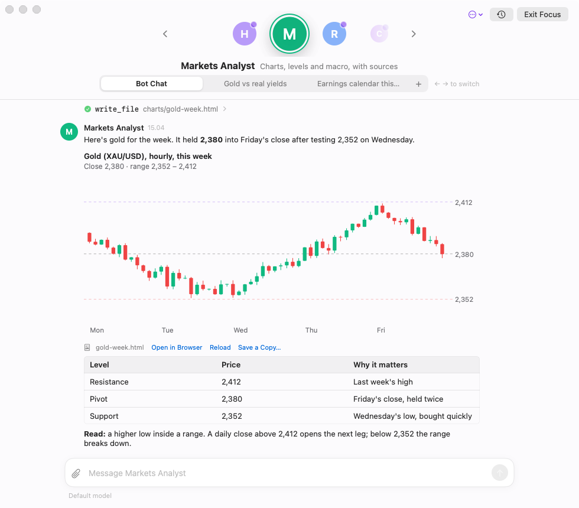
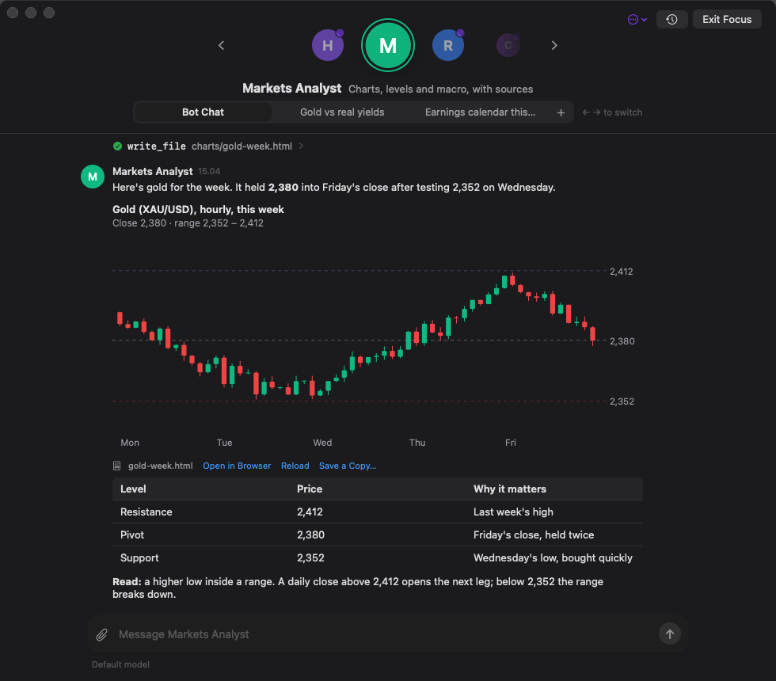

<p align="center"></p>

<h1 align="center">Agora</h1>

<p align="center"><b>A native macOS desktop for your <a href="https://github.com/NousResearch/hermes-agent">Hermes</a> Bots.</b><br>
Light and clean from day one, and it doesn't make you run Hermes on the same Mac.</p>

<p align="center">
  
  
</p>

Agora is a small SwiftUI app for talking to the Bots you run in Hermes. Hermes does the thinking, tools, memory and schedules; Agora is the window onto it. Run Hermes on a Mac mini, a home server or a VPS, and use Agora from your laptop. Or run both on one Mac.

## What it does

- **One ongoing chat per Bot**, plus **Side Chats** for separate topics (optionally starting from a summary of the main chat).
- **Replies stream in** with formatted text, tables, code, the tools the Bot used, and images.
- **Files both ways.** Send PDFs, spreadsheets, CSVs and images; get back live HTML charts and widgets right in the message (themed to light or dark mode), images, and cards for anything else (Open, Quick Look, Save).
- **Approvals and questions inline**, or from a notification, when a Bot wants to run something or needs an answer.
- **Remote first.** Connect to `hermes serve` on another machine with a token or browser sign-in, and Agora finds Hermes on your **Tailscale** tailnet for you. It reconnects by itself and picks up where it left off.
- **Manage your Bots.** Create and edit them (purpose, persona, model), see their tools, choose their **MCP servers**, and install or write **skills** for one Bot at a time.
- **Routines.** See, pause, resume, run or delete a Bot's scheduled jobs.
- **Quick Ask** from any app with ⌥Space, **Focus** mode, and a light/dark switch (⇧⌘L).

<p align="center">
  
  
</p>

**Focus** puts one Bot at a time in front of you, with nothing else around it. Switch Bots with ← and →, and move between its chats with the tabs.

<p align="center">
  
  
</p>

## Requirements

- macOS 15 or later, and Xcode 26 or later (Swift 6.2) to build it.
- Hermes **v0.23 or later**, on this Mac or another machine you can reach.

## Download

Get the latest **Agora-<version>.dmg** from [Releases](https://github.com/WillyRL/agora/releases), open it and drag Agora into Applications. It runs natively on Apple Silicon and Intel. If a release isn't notarized yet, its notes explain how to open it the first time.

Agora updates itself (**Agora → Check for Updates…**). Want the newest features early? The [Nightly](https://github.com/WillyRL/agora/releases/tag/nightly) build is made every night from `main`; switch with **Settings → General → Update channel → Nightly**, and back to Stable any time. Or build it yourself (it takes about a minute):

## Build and run

```sh
git clone https://github.com/WillyRL/agora.git
cd agora
scripts/build-app.sh
open build/Agora.app
```

On first launch, choose **On this Mac** if Hermes runs here, or **On another machine** to connect to a remote one.

### Try it without Hermes

```sh
AGORA_DEMO=1 build/Agora.app/Contents/MacOS/Agora
```

Opens Agora against a made-up Hermes with six example Bots (the screenshots above). Nothing is saved and nothing leaves the app.

### Stop the keychain prompt after every rebuild

macOS ties saved logins to the app's signature, and ad-hoc signed builds look like a new app every time. Run `scripts/make-signing-cert.sh` once per Mac: it creates a local signing certificate, and `build-app.sh` uses it from then on. On the next build macOS asks twice (once for `codesign`, once for Agora); enter your login password and click **Always Allow**. To sign with your own identity instead, set `AGORA_SIGN_IDENTITY="Developer ID Application: …"`.

## Hermes on another machine

On the machine that runs your Bots, serve Hermes where Agora can reach it. Sign-in is always required off loopback; `basic` username/password is fine on a tailnet:

```sh
hermes serve --host "$(tailscale ip -4)" --port 9119
```

In Agora, choose **On another machine** (or Settings → Connections → Add Remote…). Agora reads `tailscale status`, asks each online machine for Hermes on `https://<machine>.<tailnet>.ts.net` (Tailscale Serve) and `http://<machine>:9119`, and lists what it finds. **Connect** names the Connection after the machine and opens browser sign-in. You can also add any URL by hand and paste a session token.

## MCP servers

Settings → MCP Servers manages the servers in the main Hermes profile: switch them on or off, test the connection (and see their tools), add one by URL or command, sign in to OAuth servers in the browser, or remove one. Tokens you type are kept in the Keychain so you enter them once. Each Bot's Configure page picks which servers that Bot uses, and **Add to Bots…** adds one to several Bots at once.

## Skills

Each Bot has its own skills (its profile's `skills/` folder in Hermes). In **Configure <Bot> → Skills** you can turn a skill on or off for that Bot, view or edit its SKILL.md, write a new one (**New Skill…**), or search the skills hub and install one for that Bot only (**Get from Hub…**). Changes apply right away, and the Bot's open chats reload their skills.

## Development

```sh
swift build
swift test
```

Tests drive Agora Core against a fake Hermes that replays protocol conversations from `Tests/AgoraCoreTests/Fixtures`, so they need no Hermes and no network. Record a new fixture from the Hermes on your Mac (read-only scenarios), and check it for personal data before committing it:

```sh
swift run agora-record roster /tmp/roster.json
swift run agora-record botchat /tmp/botchat.json <profile>
```

`AGORA_SNAPSHOT=/tmp/shot AGORA_SNAPSHOT_STEPS="size:1280x860,bot:markets,wait:3"` (with `AGORA_DEMO=1`) saves screenshots of the screens you list; see `Sources/Agora/DebugSnapshot.swift`.

| Path | What |
|---|---|
| `Sources/AgoraCore` | The Hermes Connection (transport, tickets, reconnect, replay) and Agora Core: Bots, chats, files, prompts, Side Chats, Routines, MCP, skills, the demo Hermes |
| `Sources/Agora` | The SwiftUI app: windows, Quick Ask panel, notifications, global hotkey, Settings |
| `Sources/agora-record` | Records fixtures from a real Hermes |
| `Tests/AgoraCoreTests` | Recorded-conversation tests and the fake Hermes |
| `docs/` | Decisions (`adr/`), the Hermes protocol as Agora uses it (`protocol/`), the design reference (`design/`) |

Words used throughout the code and docs (Bot, Bot Chat, Side Chat, Routine, Connection…) are defined in `GLOSSARY.md`.

### Making a release

Push a version tag and the Release workflow tests, builds a universal app, packages `Agora-<version>.dmg` and `.zip` with `SHA256SUMS`, and publishes a GitHub Release:

```sh
git tag v0.2.0 && git push origin v0.2.0
```

A tag with a dash (`v0.2.0-beta.1`) becomes a pre-release, and **Actions → Release → Run workflow** makes a draft to look over first. The **Nightly** workflow rebuilds the rolling `nightly` pre-release every night when `main` has changed (or on demand from Actions).

Every release carries a signed update feed (`appcast.xml`, or `appcast-nightly.xml`) for Sparkle. Updates are signed with the `SPARKLE_PRIVATE_KEY` secret; its public half is in `scripts/package-release.sh`. Keep a copy of the private key somewhere safe: without it, installed copies can't take new updates. `scripts/package-release.sh <version>` does the same packaging locally. To have macOS open it without warnings, add the Developer ID and notarization secrets listed at the top of `.github/workflows/release.yml`.

## Contributing

Issues and pull requests are welcome. Keep changes small and focused, add or update a test for behaviour changes, and run `swift test` before opening a PR.

## License

[MIT](LICENSE). Agora is an independent project and isn't affiliated with Nous Research or the Hermes project.
