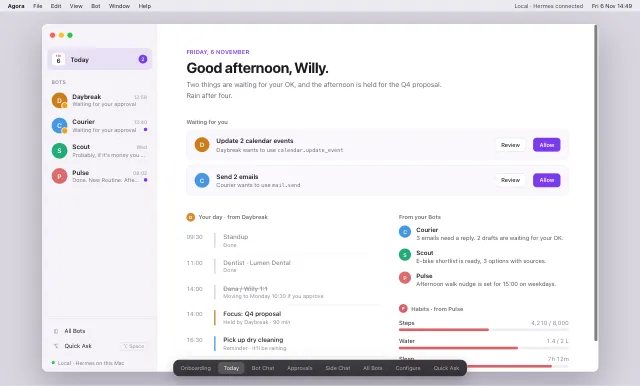

# Design reference

`agora-prototype.html` is the clickable prototype from Claude Design (synced 2026-11-06). It is the visual reference for Agora: clean, simple, quiet. Open it in a browser; `support.js` is its runtime and must sit next to it.

## Screens

| Screen | What it shows |
|---|---|
| Onboarding | Welcome, pick a Local or Remote Connection, choose which Bots go in the sidebar |
| Today | Home: greeting, approvals waiting for you, your day, updates from Bots |
| Bot Chat | Main conversation with a Bot, with Routine results, sources and an "About" side panel |
| Approvals | A Bot asks before a tool call: Allow once, Always allow, Deny |
| Side Chat | Extra tabs next to the Bot Chat; `@Bot` brings another Bot into the chat |
| All Bots | Every Bot as a card, plus templates for new Bots |
| Configure | Edit a Bot: name, colour, purpose, persona, model, tools, Routines, memory |
| Quick Ask | Floating panel on ⌥Space; pick a Bot, ask, "Continue in Bot Chat" |

## Visual basics

- System font (SF Pro), 14px body, white content area on a light sidebar.
- One accent: violet `#7c3aed` (hover `#6d28d9`), taken from `assets/icon.svg`.
- Each Bot has a colour, chosen from swatches `oklch(0.66 0.14 <hue>)`, shown as a round avatar with its initial.
- Primary action is a filled violet button; everything else is a quiet bordered button.

The Bots in the prototype (Daybreak, Courier, Scout, Pulse) are sample data, not real Hermes profiles.
